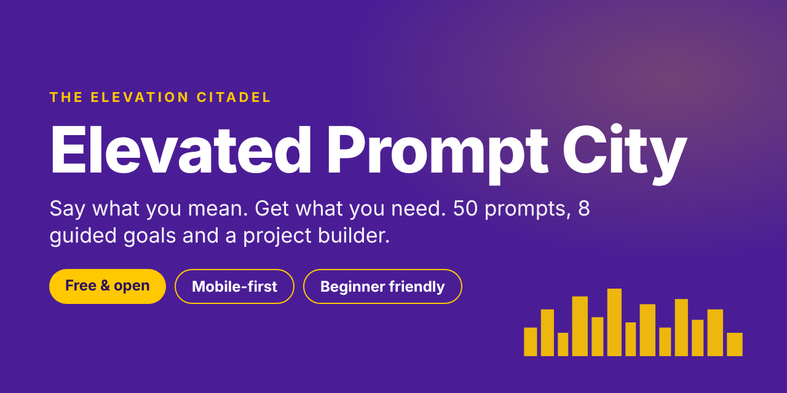

# Elevated Prompt City

**Say what you mean. Get what you need.**

A free, mobile-first prompt ecosystem for people who get weak answers from chatbots because their prompts are vague. It has 50 structured prompts, 8 goal sequences, and a project builder that turns a short form into a complete build brief.

Built by The Elevation Citadel · Tagline: *Connect. Craft. Elevate.*



## What's inside

| Section | What it does | Size |
|---|---|---|
| **Start Here** | A beginner's path into AI: four basics, weak vs strong prompt comparisons, a five-part template, a seven-day first week, and safe-use habits. Links to a free video course. | 7 steps |
| **Directory** | Ready-to-copy prompts, filterable by role, task and project, with search and favorites. | 50 prompts |
| **Navigator** | Pick a goal, get a short sequence of prompts to run one at a time in your chatbot. | 8 goals, 35 steps |
| **Foundry** | Fill in a form and get a complete build prompt that updates as you type. Includes sample projects to learn from. | 7 project types, 16 samples |

Every prompt follows the same structure: **role, objective, inputs, process, rules, output format, quality check**. Highlighted brackets mark what you still need to fill in.

## Run it

No build step and no dependencies. Open `index.html` in a browser, or host the folder on any static host (GitHub Pages, Netlify, Vercel).

```bash
# any static server works
python3 -m http.server 8000
# then open http://localhost:8000
```

## How it works

- **Your data stays on your device.** Favorites, watched-video tracking and Foundry fields are saved in your browser's `localStorage` only. Nothing is sent to a server.
- **Export** saves a Markdown file of any prompt, sequence or project brief.
- **Copy** works on every prompt, with a fallback for browsers that block the clipboard API.
- **Accessible:** keyboard-operable tabs and buttons, visible focus states, WCAG-minded contrast, and respects `prefers-reduced-motion`.
- **Light and dark** themes follow your system setting.

## Credits

The techniques behind these prompts come from 30 public projects. Every prompt is written from scratch. The full list, with links, is in the app under **Credits**. Highlights:

- [anthropics/prompt-eng-interactive-tutorial](https://github.com/anthropics/prompt-eng-interactive-tutorial)
- [dair-ai/Prompt-Engineering-Guide](https://github.com/dair-ai/Prompt-Engineering-Guide)
- [f/prompts.chat](https://github.com/f/prompts.chat)
- [coleam00/Context-Engineering-Intro](https://github.com/coleam00/Context-Engineering-Intro)
- [promptfoo/promptfoo](https://github.com/promptfoo/promptfoo)

The beginner video course linked in **Start Here** is *ChatGPT for Beginners* by Sabrina Ramonov on YouTube. Its lesson text and prompts are original wording.

## Roadmap

- Pull real video titles into the Start Here tracker
- Export a full project brief as a `.docx` or `.pdf`
- Translations (Hindi first)
- A Next.js PWA build with install-to-home-screen support

## Contributing

Issues and pull requests are welcome, especially for new prompts. Please keep prompts original, include a short example, and follow the seven-part structure above.

---

@The Elevation Citadel
